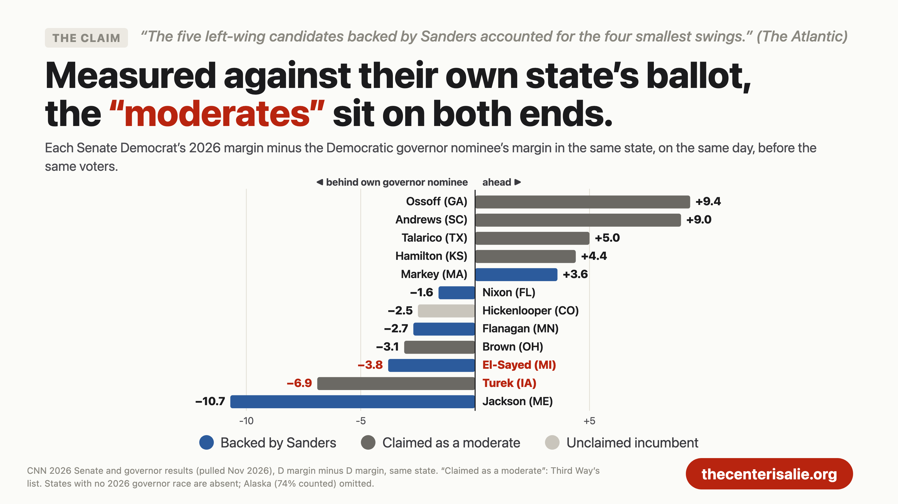
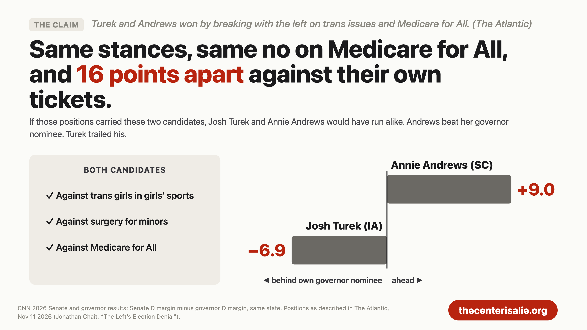
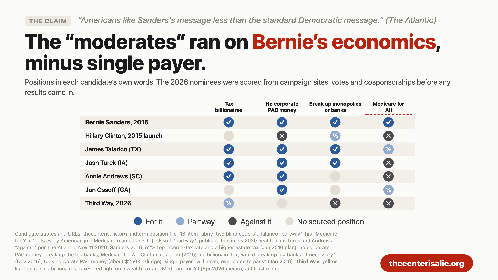
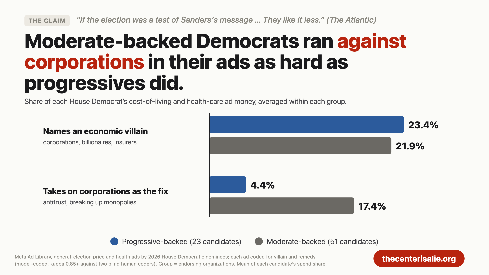
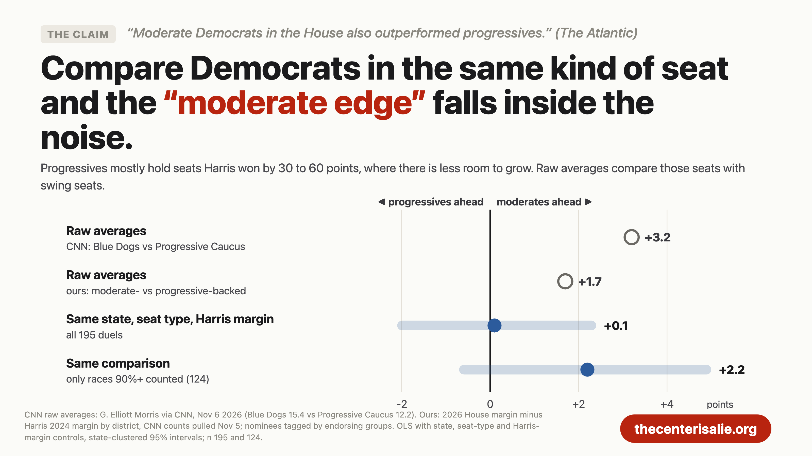

# Jonathan Chait and Matt Yglesias Never Met an Inconvenient Fact They Wouldn't Ignore

*Bernie lost in 2016. The 2026 "moderates" ran on his platform, and Jonathan Chait grades them against Kamala Harris's 2024 margin, which credits each candidate with whatever their whole state did.*

Draft for Substack, 2026-11-11. Images are the 1600×900 cards in `web/public/og/charts/`. Footnotes at the end.

---

Jonathan Chait's new piece in The Atlantic, "The Left's Election Denial," accuses progressives of refusing to accept what he says the 2026 results plainly show, which is that "the Democrats' most impressive victories in 2026 came from mainstream or moderate candidates."[1] Matt Yglesias spent the week at Slow Boring making a quieter version of the same case: the Bernie-endorsed nominee in Maine's 2nd district was "the real ideological fuckup" of the cycle, and the Democrats who won while sounding like Sanders were really just doing what Democrats have always done.[2][3]

I have spent the last week checking those claims against the vote counts, the endorsement lists, the candidates' own platforms, and the ads they ran. Both writers lean on comparisons that flatter their conclusion, skip the comparisons that don't, and hand out the label "moderate" after the votes are counted to candidates who campaigned on taxing billionaires and breaking up monopolies. Chait and Yglesias looked at a wave that Trump's failures produced and decided it was a referendum on their own factional preferences.

Start with what Yglesias himself wrote on election morning: "Trump's broken promises were the most important factors in this election."[4] He's right. Democrats ran ahead of Kamala Harris's 2024 margin in 412 of the 417 House races where a Democrat faced a Republican, by 14.4 points on average, and roughly four-fifths of the variation in that gain was the same national shift showing up everywhere.[5] Of course, now every faction in the party is laying claim to the few points left over. The rest of this piece is about those few points and about the absurdity of some of those claims.

## The Senate swing that belongs to the states

Chait's headline Senate fact is that "the five left-wing candidates backed by Sanders accounted for the four smallest swings in contested races," measured against Harris's 2024 margin in each state.[1] On that measure he's correct. The Harris baseline mixes the candidate with the state, though, and some states swung less in 2026 for every Democrat on the ballot.

Most of these states also elected a governor this year, which gives us a comparison inside each state: the Democratic governor nominee, facing the same voters, on the same day, in the same environment. Michigan's governor nominee ran only 12.2 points ahead of Harris, and Minnesota's only 8.6, so Abdul El-Sayed and Peggy Flanagan were running in states where the whole ticket moved less.[6] Subtract the governor nominee's margin from each Senate Democrat's margin and the order changes:

Chait does use this yardstick once. He scolds the New York Times for leaving out that El-Sayed trailed Michigan's governor-elect, Jocelyn Benson, by 3.9 points, a gap that "in a normal election year in a state like Michigan, could easily make the difference between winning and losing."[1] (My count has it at 3.8.) He doesn't apply the same yardstick to Josh Turek, the Iowa moderate he holds up as a model, who trailed his own governor nominee by 6.9 points, nearly twice El-Sayed's gap.[6] Sherrod Brown, Chuck Schumer's handpicked moderate in Ohio, trailed his by 3.1. Ed Markey, whom the CNN version of this argument lists among the weak Sanders performers, ran 3.6 points *ahead* of his.[6][7]

Candidates Chait calls moderates sit at both ends of that chart, with Ossoff and Andrews at the top and Turek second from the bottom, so ideology doesn't sort the Senate results.

## Same positions, sixteen points apart

Chait's theory of the moderate win is cultural. Turek and Annie Andrews "came out against gender-affirming surgery for minors and allowing transgender female athletes to compete in girls' sports—positions that did grave damage to Harris," and both, along with James Talarico and Adam Hamilton, "rejected Medicare for All."[1]

Fine. Then Turek and Andrews make a natural experiment, because by Chait's own account they ran on the same cultural positions and the same rejection of Medicare for All. If those positions are what carried them, they should have run about the same against their own tickets.

Andrews beat South Carolina's governor nominee by 9.0 points. Turek trailed Iowa's by 6.9.[6] The two candidates took the same stances and finished 16 points apart, so whatever separated those campaigns, the positions Chait credits can't be the difference.

## Bernie's 2016 platform, ten years later

Neither piece lines these winners up against what the center offered when Sanders ran. Before a single result came in, we scored every Senate nominee on progressive positions, using their own words, votes, and cosponsorships.[8] Then we lined the winners up against three benchmarks from ten years ago: Bernie Sanders's 2016 platform,[9] the platform Hillary Clinton launched with in 2015, and what Third Way, the centrist think tank that spent this cycle telling Democrats to run to the middle, was pushing at the time.

- James Talarico: "Make billionaires pay their fair share in taxes"; no corporate PAC money "since my very first race"; antitrust legislation to "Break up Big Medicine"; a $15 minimum wage, and in July, "$15 is not going to be enough"; "eliminating the tax cap on the highest earners" for Social Security; and "Medicare for Y'all," which would "allow every American to join Medicare."[10]
- Josh Turek: "close loopholes for billionaires and big corporations"; no corporate PAC money; "Crack down on monopolies in agribusiness and meatpacking"; and to seniors, "I will do everything I can to protect Medicare, Medicaid, and Social Security, and expand it to all of you."[11]
- Annie Andrews: "End tax breaks for the ultra-wealthy and corporate polluters"; no corporate PAC money; and raise the Social Security wage cap "so that the very wealthiest among us pay more into the system."[12]
- Jon Ossoff, whom Chait names as a model mainstream winner: no corporate PAC or lobbyist money, a $15 minimum wage bill in 2021, and a public option in his 2020 health plan.[13][14]

Now look at where the center stood when Sanders ran. Clinton launched her campaign with no billionaire tax, said "I favor a $12 an hour minimum wage," allowed only that "we do have to look at the cap" on Social Security, and told Iowa voters that single payer would "never, ever come to pass."[15][16] Third Way wanted to raise the full retirement age to 68, trim cost-of-living increases through chained CPI, and insisted that Social Security reform "must be achieved principally through savings in benefits, not tax increases."[17] Its 2015 wage plan topped out at "$10-$12 by 2020," depending on the region.[18] In January 2016 it called Sanders's Social Security plan "not progressive."[19]

Ten years later, Third Way itself has walked toward Sanders. In 2019 it announced that "Democrats are united on the need for a $15 minimum wage," on a regional phase-in.[20] This September it published a memo on lifting the Social Security tax cap that lists a higher retirement age as just one option among several.[21] In April it told candidates that voters are "right" that the system is "rigged," and said, "sure, talk about raising their taxes" on the ultra-rich, while still drawing the line at a wealth tax and Medicare for All.[22] And the candidates Chait calls moderates went further than Third Way did: scrapping the cap on top earners, $15 and up, and no corporate PAC money at all. Third Way's own published positions still sit on the opposite side of 9 of our 13 items from Talarico's, and Talarico posted the biggest Senate gain of the year.[23]

The 2026 winners did drop single payer, and Chait is right about Turek and Andrews. He overstates the case on Talarico. Talarico told the Texas Tribune that "universal health care is a human right" and ran on letting every American join Medicare, which stops short of single payer.[24] He closed his victory speech calling for "universal health care."[25] Talarico's position sits left of where the center stood in 2009. Jacob Hacker proposed the public option around 2001, and in 2009 Joe Lieberman, a moderate Democrat, forced it out of the Affordable Care Act.[26] Clinton put a public option and a Medicare buy-in at 55 at the center of her health plan on July 9, 2016, after talks with the Sanders campaign and three days before he endorsed her.[27] Ossoff, whom Chait counts as mainstream, ran on a public option in 2020, and Talarico's 2026 plan goes further.[13]

Sanders lost the 2016 primary on a platform that much of Chait's winning roster now campaigns on, minus single payer, and Third Way spent the same decade moving toward it.

On November 10 Yglesias agreed it was "factually accurate" that many winning Democrats "say things about the political economy of the United States that sound like things Bernie Sanders might say," but argued that rigged-system rhetoric "is just how Democrats talk," going back to Bill Clinton and to Al Gore's "the people, not the powerful."[3] He's right that the language predates Sanders. He leaves out what the centrists said about it the last time it lost. After Gore's defeat, Bill Clinton's pollster Mark Penn wrote that "Al Gore used an old-style populism that limited his appeal rather than expanded it" and that "Gore sounded divisive" when he pitted the people against the powerful. Will Marshall of the Progressive Policy Institute called it "a hackneyed populism."[28]

When economic populism loses, it belongs to Bernie Sanders and the "left-factionalists" Yglesias says he doesn't want "running economic policy in 2029."[3] When it wins, it becomes just how Democrats talk, and the credit goes to whatever cultural position the winner happened to take. Yglesias even lists the ideas he does consider "distinctively Sandersite": Medicare for All, a wealth tax, and antitrust "that emphasizes corporate power and market concentration."[3] Turek and Talarico both ran on that last one.[8]

## The ad money

The ads match the platforms. We coded every cost-of-living and health-care ad that House Democrats ran on Meta in the general election, and the Democrats backed by moderate groups went after corporations just as hard as the progressives did.

Moderate-backed Democrats put 22% of their price-ad money into naming an economic villain (corporations, billionaires, insurers), against 23% for progressive-backed Democrats. And moderate-backed Democrats put 17% into taking on corporations as the fix for high prices, four times the progressive-backed share.[29] Chait writes that if the election tested "whether Americans like Sanders's message more or less than the standard Democratic message, the answer was clear: They like it less."[1] The standard Democratic message in the races he's celebrating *was* the anti-corporate economic message.

## House averages from different kinds of seats

Chait says that "by the same measure, moderate Democrats in the House also outperformed progressives."[1] That measure is a raw average, and it's the same one CNN used last week, built on G. Elliott Morris's numbers: Progressive Caucus members ran 12.2 points ahead of Harris, Blue Dogs 15.4.[7] A raw average compares Democrats in very different seats. Progressive Caucus members mostly hold seats Harris won by 30 to 60 points, where there's far less room to grow, and Blue Dogs mostly run in seats Trump won.

So we compared Democrats in the same state, in the same kind of seat, against the same Harris margin:

Across all 195 head-to-head comparisons, the moderate edge is 0.1 points, with a 95% interval running from 2.1 points in progressives' favor to 2.4 in moderates'.[30] And by the raw-average method Chait and CNN both used, the candidates from the Democratic Socialists of America came out on top of Morris's table, 16.5 points ahead of Harris and above the Blue Dogs.[7] Nobody at The Atlantic is writing that the socialists won the House, which tells you how much weight the method deserves.

## Maine, and the seats nobody mentions

Both writers lean hard on Maine's 2nd district. Matt Dunlap lost a seat Democrats held, and he ran about 4.5 points behind Democrats in comparable Trump-won seats.[31] That's a real data point against him. But Chait's framing, that Jared Golden "retired in the face of a progressive primary challenger," skips that Dunlap still ran 7.4 points ahead of Harris in a district Trump carried by 9.[31] And ME-2 wasn't the only Democratic seat lost. In Memphis, the progressive Justin Pearson ran 20.0 points ahead of Harris in a TN-09 redrawn to a Trump +21 seat, nearly three times Dunlap's overperformance, and lost anyway.[32] Nobody wrote that Pearson was the cycle's "ideological fuckup," because the map beat him, and everyone could see it.

Then there's Susan Collins. Chait calls it "bizarre" to excuse Troy Jackson's margin by pointing out that Collins was the toughest Republican on the map, because Collins is tough precisely *because* of her moderate reputation.[1] Take that seriously for a second. If moderation is worth the two to three points Chait cites from the political science, Collins had it, along with three decades of incumbency, and the Sanders-backed candidate beat her anyway.[1][33]

## The ballot measures he picked

Chait writes that ballot measures "rejecting a wealth tax" confirmed the public's limits on the left.[1] He means California's Proposition 40, a one-time 5% tax on billionaire wealth, which appears to have failed after billionaires reportedly spent more than $340 million against it.[34] He doesn't mention that on the same night, Washington voters were poised to keep their brand-new 9.9% tax on income over $1 million, that Colorado voters looked set to approve graduated income-tax rates that raise taxes on the highest earners, or that Californians voted to keep the state's top income-tax rates permanent.[34] Higher taxes on top earners passed or survived in Washington, Colorado and California, and billionaires spent hundreds of millions against the one measure that lost.

## The political science on extreme candidates

Chait's strongest move is the academic one: "congressional candidates who advocate more ideologically extreme positions tend to do worse," and even Morris estimates moderation was worth two to three points in 2024.[1] The literature is sound, and Chait applies it to a label those studies never measured. Those studies measure candidates' positions, usually their roll-call records or their stated platforms. The 2026 "moderates" got their label from which groups endorsed them and from one or two cultural stances, while running on billionaire taxes, corporate-money pledges, and antitrust. You can't take a finding about ideological positions and use it to award credit to a label that the candidates' own platforms contradict.

Chait also writes that Third Way predicted "moderates would overperform baseline partisanship, and that progressive candidates would underperform," and that "that is precisely what happened."[1] Third Way's prediction missed. Compare like with like and the two groups finish within noise of each other in the House, and the Senate "moderates" land at both ends of the ticket comparison.

## Results that favor Chait

Some results point Chait's way. In competitive House seats where at least 90% of the vote was counted, progressive-backed nominees ran 1.4 points behind unaligned Democrats and moderate-backed nominees 1.5 points ahead. Both estimates sit inside the noise, but they point Chait's direction, and our House counts date from November 5, so final counts could move them.[35] Troy Jackson ran 10.7 points behind Maine's governor nominee, though he entered the race in July after the original nominee withdrew.[6] Dunlap trailed comparable Democrats, as I said above. And the populist message itself didn't predict who ran furthest ahead: House Democrats who spent more of their price ads naming an economic villain ran slightly behind, and that link fades below significance once money is controlled.[36] Our numbers show the moderates ran populist economics. They don't show that populism won the seats, and they don't show that moderation won them either.

## The bottom line

Strip away the raw averages, the Harris baseline that ignores each state's own ballot, and the labels handed out after the fact, and three things remain: a wave that Trump's failures built, a party whose winners across the spectrum ran on taxing billionaires and fighting corporate power, and factions that finish within a few points of each other once you compare them in the same kinds of seats. Chait calls the left's reading of this election denial. Ten years ago, Clinton launched without a billionaire tax, Third Way wanted to raise the retirement age, and both stopped short of $15. In 2026, the candidates Chait and Yglesias are crowning ran on taxing billionaires and lifting the Social Security cap, and the biggest winner of them all said "$15 is not going to be enough." The denial here belongs to the people claiming that platform as a win for the center.

---

## Notes

1. Jonathan Chait, "The Left's Election Denial," The Atlantic, 2026-11-11 (read via the archive.today capture of 2026-11-11 18:53 UTC).
2. Matthew Yglesias, "Seventeen thoughts on an epic repudiation of Donald Trump," Slow Boring, 2026-11-04.
3. Matthew Yglesias, "Bernie Sanders did not invent populist rhetoric," Slow Boring, 2026-11-10.
4. Matthew Yglesias, "The way forward," Slow Boring, 2026-11-04.
5. CNN 2026 House counts (pulled 2026-11-05) against Harris 2024 by district; `data/derived/midterm2026/factors_wave.csv`.
6. CNN 2026 Senate and governor results; Senate D margin minus governor D margin, same state; `data/derived/midterm2026/rebuttal_senate_vs_gov.csv`. States without a 2026 governor race (including North Carolina) are absent. Alaska (74% counted) is omitted from the chart.
7. Aaron Blake, "Midterm returns show bad news for progressive Democrats," CNN, 2026-11-06, with House group averages from G. Elliott Morris (DSA n 7).
8. `data/derived/midterm2026/rebuttal_senate_positions.csv` (13-item rubric, two blind coders, 88% cell agreement, source URLs per quote). Medicare for All positions for Turek and Andrews as reported in note 1; Talarico's from note 24.
9. Sanders 2016: "Sanders Introduces Bill for $15 an Hour Minimum Wage," sanders.senate.gov, 2015-07-22; statement on Clinton and Social Security, 2016-02-05 (presidency.ucsb.edu); 2016 campaign tax plan (52% top rate, higher estate tax), Tax Policy Center analysis.
10. AARP, "Texas Senate candidates Q&A," 2026-09-01; Greg Groogan, FOX 26 Houston, 2026-07-01; jamestalarico.com issue pages.
11. KTTC, "US Senate candidate Turek wants these people to pay more Social Security taxes," 2026-09-10. KTTC's reporter, not Turek, describes him as backing removal of the cap.
12. SC Daily Gazette via News From The States, Senate debate coverage, 2026-10-11.
13. Jon Ossoff, health care plan, 2020-08-24 (electjon.com); AJC, "Ossoff's healthcare policy features public option plan," 2020. His 2026 position on a public option was not found.
14. Office of Sen. Jon Ossoff, 2021-01-26, on introducing the $15 minimum wage bill.
15. "Hillary Clinton: Single-payer health care 'will never, ever' happen," CBS News, 2016-01-29.
16. Clinton on MSNBC, 2015-11-03 ("I favor a $12 an hour minimum wage"), as cited by PolitiFact; Clinton in New Hampshire, 2015-08-12, quoted by National Journal via GovExec, "Clinton Moving Left on Social Security," 2015-08-13.
17. Jim Kessler and David Kendall, "Saving Social Security," Third Way, 2011-01-20; David Brown, "The Context and the Case for Chained CPI," Third Way, 2013-04-11.
18. Jonathan Cowan, Jim Kessler, Gabe Horwitz and Joon Suh, "Ready for the New Economy," Third Way, 2015-10-28.
19. Jim Kessler and David Brown, "How the Sanders Social Security Plan is Not Progressive," Third Way, 2016-01-29.
20. Gabe Horwitz, "Third Way Statement on the PHASE-in $15 Wage Act," Third Way, 2019-04-04.
21. Gaudette and Moller, "So, You Want to Raise the Social Security Tax Cap?" Third Way, 2026-09-10. The memo lists options and endorses none.
22. "Testing the Limits of Economic Populism," Third Way, 2026-04-02.
23. `data/derived/midterm2026/coding_c_talarico_vs_thirdway.csv`; Third Way positions from its published memos.
24. "On the issues: A Q&A with the Texas Democrats running for U.S. Senate," Texas Tribune, 2026-02-04 (Talarico's answer); jamestalarico.com/issue/health-care ("Allow every American, regardless of their age, to join Medicare"). A Lone Star Left post (Michelle H. Davis, 2025-12-28) reports his campaign said he "would vote in favor of Medicare for All"; that is secondhand and not used in the text.
25. Kate Aronoff, "Leftists Weren't the Only Ones Who Moderated in the Midterms," The New Republic, 2026-11-10.
26. Jacob Hacker, "Proposing the Public Option," in Celebrating 20 Years of New America; Wikipedia, "Public health insurance option" (Lieberman's opposition, December 2009).
27. "With nod to Sanders, Clinton offers new health care proposal," Associated Press via Boston.com, 2016-07-09; KFF Health News morning briefing, "With eye on Sanders endorsement, Clinton offers expanded health care proposal," 2016-07-11.
28. Mark J. Penn, "Lessons of 2000," and Will Marshall, "Dems: Round Two," in "The Democrats' Next Step," The American Prospect, 2001-12-19.
29. Meta Ad Library, general-election price and health ads by 2026 House Democratic nominees; mean share of each candidate's spend by code, moderate-backed n 51, progressive-backed n 23; model-coded, kappa 0.85+ against two blind coders; `data/derived/midterm2026/rebuttal_frames_by_affiliation.csv`.
30. OLS of gain over Harris on affiliation, state, seat type and Harris margin, state-clustered SEs; `data/derived/midterm2026/house_drivers_duel.csv`. Races at least 90% counted (n 124): moderate edge 2.2 points (95% CI −0.7 to +5.0).
31. `data/derived/midterm2026/house_all.csv`; comparison group: non-Democratic-incumbent seats with Harris margin between −14 and −4 (n 38), average gain 11.9, 21 won.
32. `data/derived/midterm2026/rebuttal_d_seats_lost.csv`, CNN counts as of 2026-11-05.
33. G. Elliott Morris, "Moderation Is Not a Silver Bullet," as quoted in note 1.
34. Aidan Davis and Jon Whiten, "Voters Pass Ballot Measures to Raise and Protect Revenue, Tax the Rich," ITEP, 2026-11-05. Results described there as preliminary.
35. `data/derived/midterm2026/rebuttal_competitive.csv`: House races with Harris margin under 10, HC1 SEs. Progressive-backed −1.4 (95% CI −4.8 to +2.1, n 17); moderate-backed +1.5 (−1.0 to +4.1, n 66).
36. `data/derived/midterm2026/emphasis/frame_models.csv`, prediction F1, n 109: about −0.3 points per 10 share points of villain framing.
